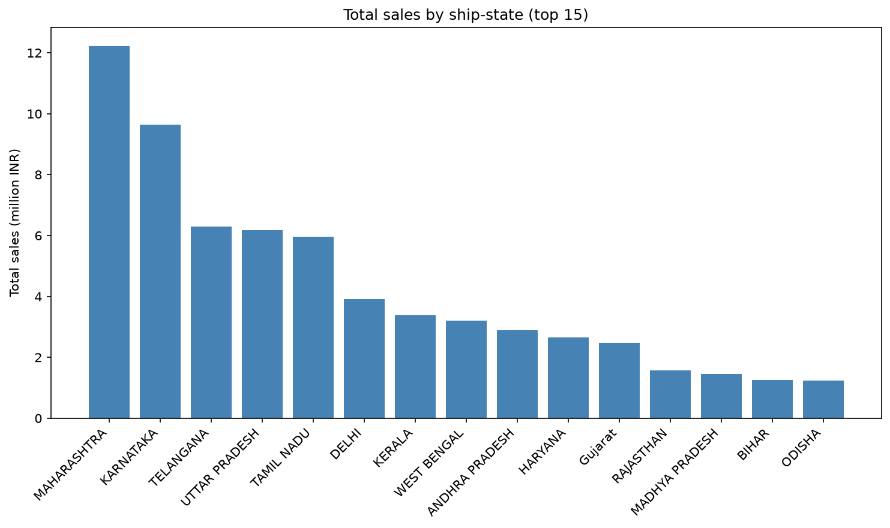
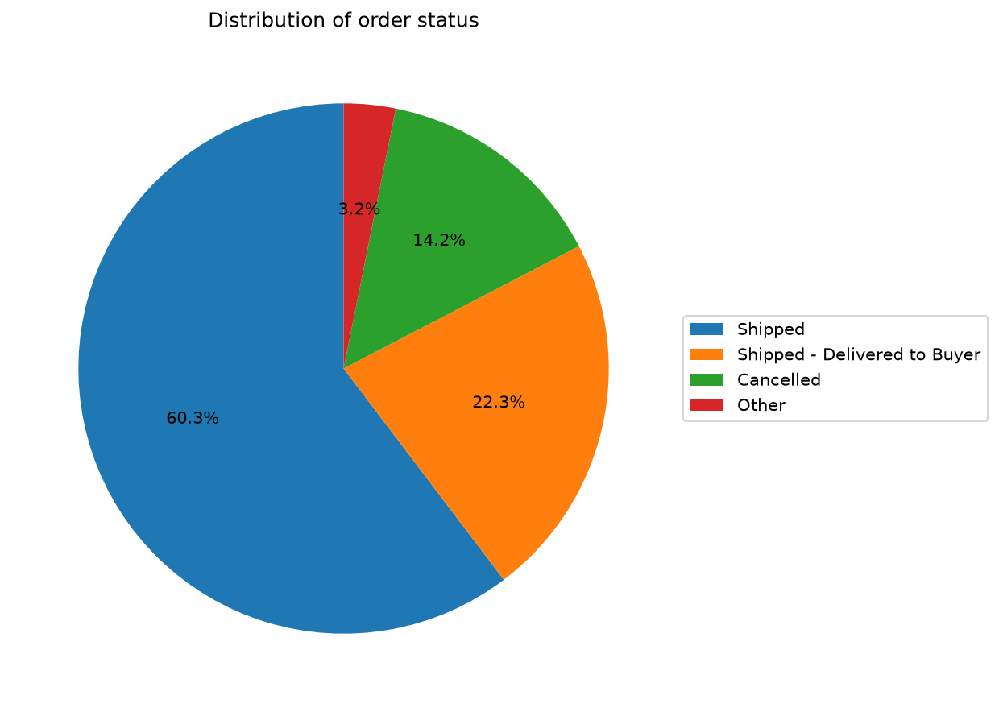
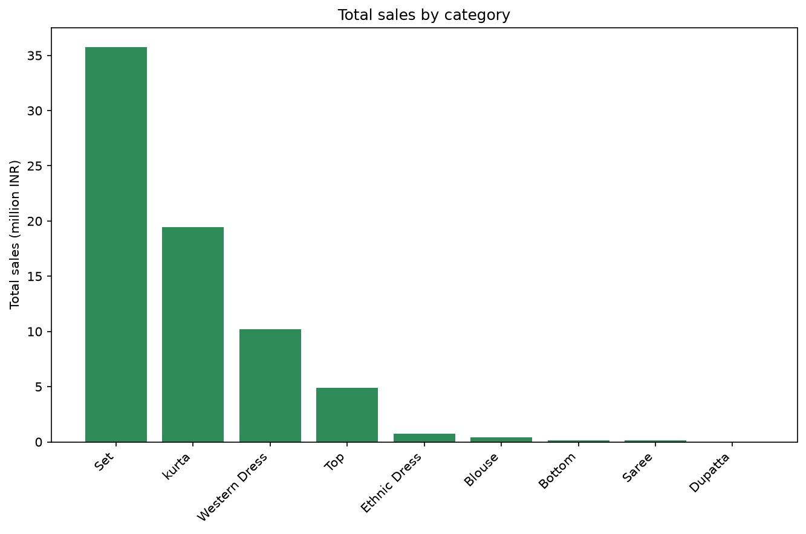
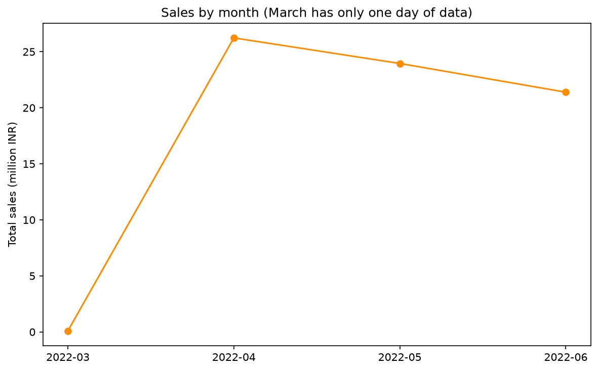

# Integrated Inventory and Analytics System

CSQ242 Work Integrated Training-I, Project 1.

A command-line system that loads a year of raw Amazon order data into memory, controls who can read or change it through user roles, and answers sales, cancellation, seasonality, turnover and promotion questions. Every search, sort, aggregation and index is written from scratch using core Python data structures. No pandas, numpy or `csv` module is used. matplotlib is used only to draw charts from numbers this project computes itself.

## Requirements

- Python 3.12
- matplotlib (`pip install matplotlib`)
- The dataset `Amazon Sale Report.csv` (the Kaggle "Amazon Sale Report" file)

## Setup

```bash
git clone <your repository URL>
cd inventory-system
py -3.12 -m venv venv
source venv/Scripts/activate        # Git Bash on Windows
pip install matplotlib
```

Download `Amazon Sale Report.csv` and place it in the `data/` folder. The data file is not stored in this repository because of its size.

## Run

```bash
python main.py
```

To use a CSV stored somewhere else:

```bash
python main.py "path/to/Amazon Sale Report.csv"
```

After loading, the program prints how many rows were loaded, skipped and repaired, then asks you to log in.

## Demo accounts

Users are held in memory only, and passwords are stored as salted SHA-256 hashes.

| Username | Password | Role |
|---|---|---|
| `manager` | `manager123` | Manager |
| `junior` | `junior123` | Junior Manager |

| Action | Manager | Junior Manager | Not logged in |
|---|---|---|---|
| Search, sort, analyses, charts | Yes | Yes | No |
| Add, edit, delete orders | Yes | No | No |

A blocked action raises a clear `PermissionDenied` message.

## What the menu offers

- **Search** by Order ID (binary search), ship-city (hash index), Status or Category (linear search)
- **Sort** by Date, Amount or Qty (merge sort)
- **Analyses:** top products by amount or quantity, sales by city or state, orders per status, category totals, top orders by value, cancellation rates as a stockout proxy, monthly and quarterly volume, peak month per category, inventory turnover, and promotion analysis
- **Charts:** four matplotlib charts saved to `charts/`
- **Manager only:** add, edit and delete orders

## Project structure

```
inventory-system/
  main.py               entry point
  data/                 put the CSV here (not committed)
  charts/               generated charts
  src/
    order.py            Order class
    order_manager.py    loading, role checks, add/edit/delete, search, sort
    users.py            UserManager, roles, login errors
    algorithms.py       linear/binary search, hash index, quick/merge/heap sort
    analysis.py         Part 3 items 1-5
    analysis_advanced.py  Part 3 items 6-9
    indexing.py         Order-ID binary search, SKU and city hash indexes
    charts.py           matplotlib charts
    cli.py              command-line interface
  REPORT.md             assumptions, results and written algorithm answers
```

## Charts






## Tests

Small scripts in the project root check each part. Run any of them with `python <name>`:

| Script | Checks |
|---|---|
| `test_load.py` | CSV loading |
| `test_roles.py` | logins and role permissions |
| `test_algorithms.py` | sorts, binary search, hash index, heap |
| `test_analysis.py`, `test_analysis2.py` | analyses |
| `test_index.py` | indexed lookups against linear search |
| `test_charts.py` | chart creation |
| `test_skiplog.py` | skipped and repaired rows on deliberately broken data |

## Notes on the data

The file covers 2022-03-31 to 2022-06-29, about three months. Cancelled orders are excluded from sales totals because they carry an Amount but a Qty of 0. The full list of assumptions, results and the written algorithm answers is in [REPORT.md](REPORT.md).